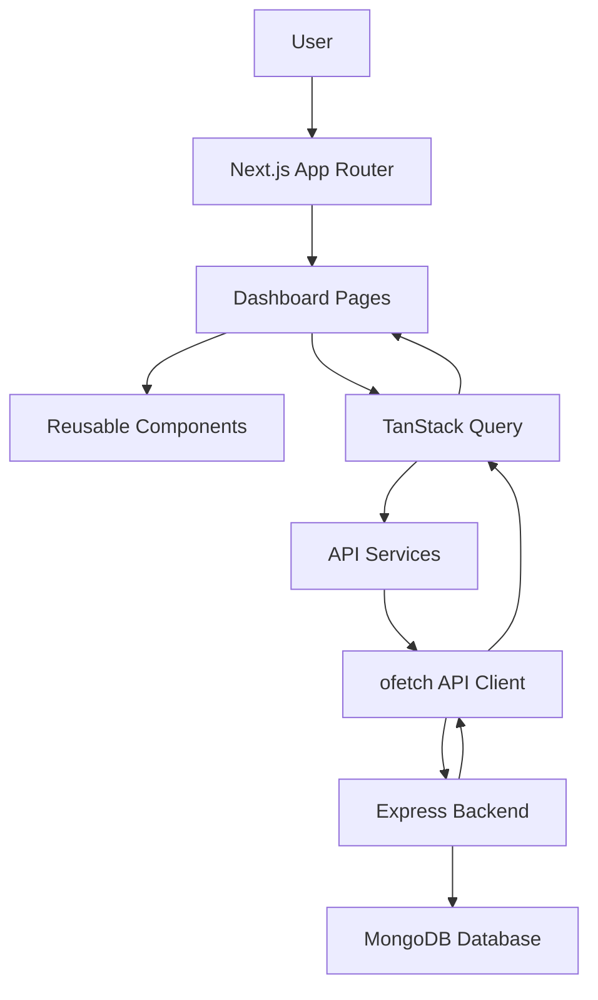

# Doctor Tracker – Frontend

Doctor Tracker is a modern and responsive healthcare administration platform built with **Next.js, TypeScript, and Tailwind CSS**. It provides an intuitive interface for administrators to manage doctors and patients, monitor healthcare records, and visualize important statistics through interactive dashboards.

## Features

- Secure admin login and protected dashboard routes
- Dashboard overview with summary cards
- Doctor management
- Patient management
- Assign and manage patients under doctors
- Search and filtering functionality
- Pagination for doctor and patient lists
- Doctor-wise patient views
- Date-based dashboard analytics
- Interactive charts and data visualization
- Responsive UI for desktop, tablet, and mobile
- Form validation and toast notifications

## Technology Stack

- Next.js (App Router)
- React
- TypeScript
- Tailwind CSS
- TanStack Query
- TanStack Form
- Zod
- shadcn/ui
- ofetch
- Recharts
- Motion
- Lucide React
- Sonner

## Project Structure

```text
src/
├── app/
│   ├── (dashboard)/
│   │   ├── admin/
│   │   ├── doctor/
│   │   └── patient/
│   ├── (public)/
│   └── layout.tsx
├── components/
│   ├── dashboard/
│   ├── public/
│   └── ui/
├── api/
├── hooks/
├── lib/
├── routes/
└── types/
```

## Installation Guide

### 1. Clone the Repository

```bash
git clone YOUR_FRONTEND_REPOSITORY_URL
cd doctor-tracker-fontend
```

### 2. Install Dependencies

```bash
npm install
```

### 3. Configure Environment Variables

Create a `.env.local` file in the root directory.

Use this `.env.example`:

```env
NEXT_PUBLIC_API_BASE_URI=http://localhost:5000/api
```

### 4. Run the Development Server

```bash
npm run dev
```

Frontend will be available at:

```text
http://localhost:3000
```

## System Architecture

The frontend uses Next.js App Router for application routing and TanStack Query for server-state management. API requests are handled through a centralized ofetch API client, while reusable components provide a consistent user interface.



### Application Flow

1. The administrator logs in.
2. Protected routes verify authentication.
3. Dashboard pages request data through TanStack Query.
4. API services communicate with the Express backend.
5. The backend processes requests and returns JSON responses.
6. TanStack Query manages server data and caching.
7. Components display the updated information.

## Technical Decisions

### 1. TanStack Query for Server-State Management

TanStack Query was selected to manage API data instead of manually managing server state with React Context. It provides caching, automatic refetching, loading and error states, and query invalidation. This makes doctor and patient management more efficient and keeps the UI synchronized with backend data.

### 2. TanStack Form with Zod Validation

TanStack Form and Zod were selected for structured form handling and validation. TanStack Form manages form state and submission, while Zod defines reusable validation schemas. This approach improves type safety, maintains consistent validation rules, and reduces unnecessary form logic.

## Visual Evidence

Add high-quality screenshots of the application.

### Desktop Screenshots

Place desktop screenshots inside `public/screenshots/`.

| Section | Screenshot |
|---|---|
| Dashboard Overview | `public/screenshots/dashboard-desktop.png` |
| Doctor Management | `public/screenshots/doctors-desktop.png` |
| Patient Management | `public/screenshots/patients-desktop.png` |

### Mobile Screenshots

| Section | Screenshot |
|---|---|
| Dashboard Mobile | `public/screenshots/dashboard-mobile.png` |
| Doctor Management Mobile | `public/screenshots/doctors-mobile.png` |
| Patient Management Mobile | `public/screenshots/patients-mobile.png` |

### Preview

When screenshots are added, display them using Markdown:

```md


```

## Project Links

- **Live Application:** YOUR_FRONTEND_LIVE_URL
- **Frontend Repository:** YOUR_FRONTEND_REPOSITORY_URL
- **Backend Repository:** YOUR_BACKEND_REPOSITORY_URL

## License

This project was developed for educational and portfolio purposes.